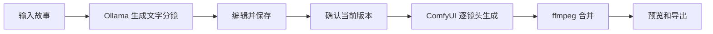

# 镜序项目文档

镜序（Ollama Video / Storyboard Studio）的项目使用与开发文档，由本仓库维护，与当前源码实现对应。

| 文档 | 适合谁 | 内容 |
| --- | --- | --- |
| [安装与构建](installation.md) | 首次安装 | 环境、模型目录、构建与启动 |
| [使用手册](user-guide.md) | 视频创作者 | 故事输入、分镜编辑、确认与导出 |
| [配置参考](configuration.md) | 本地部署用户 | 路径、端口、环境变量与数据 |
| [常见问题](troubleshooting.md) | 遇到问题的用户 | 连接、模型、生成、取消与恢复 |
| [开发与接口](development.md) | 开发者 | 架构、测试、API 与版本约束 |
| [贡献指南](../CONTRIBUTING.md) | 贡献者 | 修改、验证与提交规范 |

## 工作方式

当前输出为 512×288、12 fps、无声视频，分镜为文字。模型权重需要单独准备。先完成短片验证，再增加镜头数量和总时长。

[返回仓库首页](../README.md)
